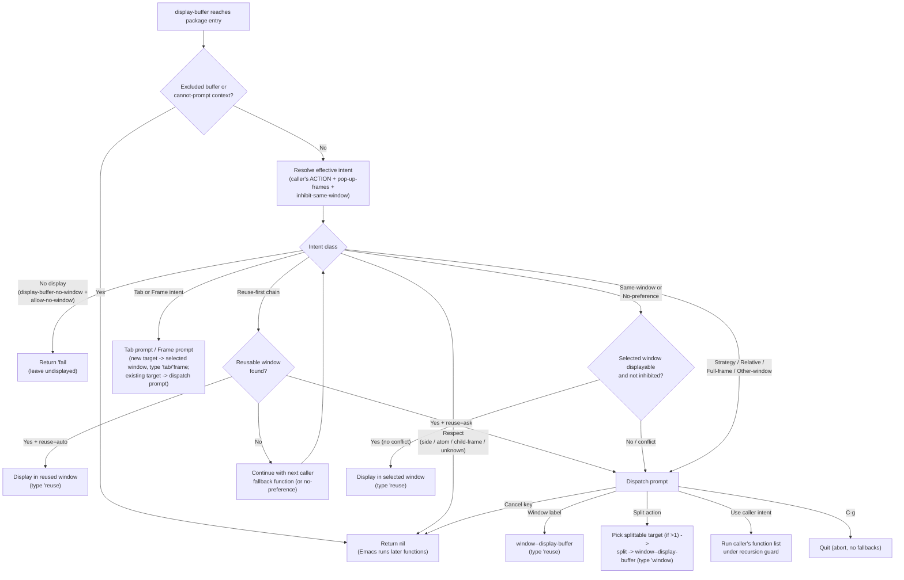

# DESIGN_RULESET

This file is the design authority for `disbuf-pivot`.  It describes the
intended behavior; the current v0.1.0 source does not yet implement all
of it.  `docs/DOCUMENTATION_CONVENTION.md` is the authority for terms
and prose; `CONTRIBUTING.md` for commands, verification, commits, and
changelog entries; `docs/DISPLAY_BUFFER_MATRIX.md` is the non-normative
Emacs 31.1 reference matrix verified against `window.el.gz` and
`tab-bar.el.gz`.

## 1. Goal, scope, and non-goals

`disbuf-pivot` replaces an implicit `display-buffer` choice with an
explicit one.  It aims for predictable display management, zero
surprises, and explicit user control at the pivot.

The package is a policy layer: it calls Emacs action functions or
`window--display-buffer` as display primitives, while target selection
and prompting remain the package's.

**In scope:**

- Every `display-buffer` call that reaches the package's
  `display-buffer-alist` entry.
- The four package prefix commands (`disbuf-pivot-prefix-mode`).
- The tab prompt and frame prompt used at and outside the pivot.

**Out of scope / non-goals:**

- `switch-to-buffer` remains default and obeys display rules only when
  `switch-to-buffer-obey-display-actions` is non-nil.
- Calls already handled by `display-buffer-overriding-action` or an
  earlier `display-buffer-alist` entry.  For pop-up windows, pair
  `disbuf-pivot` with a manager such as `column-popup` or `popper`:
  both cons at the front of `display-buffer-alist` when enabled, so
  enable `disbuf-pivot-action-mode` first and the pop-up manager second.
  `disbuf-pivot` does not force an order.
- Noninteractive and cannot-prompt contexts (section 10), including
  completion previews, timers, process filters, and keyboard macros.
- Automatic splitting: `disbuf-pivot-window-utility-split-p` and its
  options are not consulted by the redesigned core; splitting is an
  explicit user dispatch action.
- Frame preview (not part of this design; tab preview with `consult`
  remains optional).

**Legacy and global Emacs display variables:**

- `display-buffer-mark-dedicated`: honored naturally through
  `window--display-buffer` for new windows unless a `dedicated` entry
  (or a window-setting toggle shadowing it with `nil`) overrides it.
- `pop-up-frames` (including `'graphic-only`) and
  `display-buffer-reuse-frames`: honored when `reusable-frames` or
  frame intent is resolved (section 3).
- `same-window-buffer-names`, `same-window-regexps`,
  `special-display-buffer-names`, `special-display-regexps`,
  `pop-up-windows`, and functions in `display-buffer-base-action`:
  preempted while `disbuf-pivot-action-mode` regulates the buffer
  (because the package's `display-buffer-alist` entry runs before the
  special action, base action, and fallback action).  Use
  `disbuf-pivot-exclude-conditions`, an earlier `display-buffer-alist`
  entry, or the cancel key (nil choice) when those rules should govern
  a buffer.  Action alist entries in `display-buffer-base-action` are
  still read through the combined action alist.

**Predictability and zero surprises:** the same caller intent, window
state, and options always produce the same target or the same dispatch
prompt; there is no hidden cache across multiple `display-buffer` calls
in one command.

## 2. Window predicates: displayable, eligible, and splittable

Emacs window operations distinguish three independent properties that
must not be conflated:

1. **Displayable for `buffer`**: live, not a minibuffer window, not a
   side window (`(window-parameter win 'window-side)` is nil), and not
   dedicated to *another* buffer (`(or (not (window-dedicated-p win))
   (eq buffer (window-buffer win)))`).
2. **Eligible for direct display** in the current dispatch prompt: a
   displayable window not excluded by explicit *user* prefix intent
   (`disbuf-pivot-other-window-prefix` marks the selected window
   ineligible).  **Caller intent never makes a displayable window
   ineligible**: caller preferences (`inhibit-same-window`,
   `display-buffer-pop-up-window`, `display-buffer-use-least-recent-window`,
   `display-buffer-full-frame`, etc.) affect caller intent info and the
   dispatch prompt default, never blocking the user from choosing any
   displayable window.
3. **Splittable target** for a split action: live, not a minibuffer
   window, not a side window, and its frame does not have a non-nil
   `unsplittable` parameter.  **A dedicated normal window is
   undisplayable yet splittable.**

| Window kind | Displayable for `buffer`? | Eligible (direct display)? | Splittable target? |
|---|---|---|---|
| Normal window (non-selected) | Yes | Yes | Yes |
| Normal window (selected) | Yes | Yes (`No` for `other-window-prefix`) | Yes (including `other-window-prefix`) |
| Dedicated to *this* `buffer` (non-side) | Yes | Yes | Yes |
| Dedicated to *another* buffer (non-side) | No | No | **Yes** (new split is non-dedicated) |
| Side window | No | No | No (`split-window` signals error) |
| Minibuffer / dead window | No | No | No |

**Verified Emacs 31.1 quirks behind these predicates:**

- `split-window` on a hard-dedicated normal window (`set-window-dedicated-p`
  set to `t`) succeeds and makes a fresh **non-dedicated** window while
  leaving the original window dedicated.  Thus, even when every normal
  window on a frame is dedicated, a split action still produces a clean
  displayable window.
- `split-window` on a side window signals `"Cannot split side window or
  parent of side window"`; on a minibuffer it signals an error.
- `display-buffer-same-window` (`window.el.gz:8489`) rejects *any*
  dedicated window — even one dedicated to `buffer` itself — and does
  not check `window-side`.  Therefore `disbuf-pivot` tests its own
  per-buffer displayable predicate and calls `window--display-buffer`
  directly rather than delegating blindly to
  `display-buffer-same-window`.
- Splitting a constituent of an atomic window (`window-atom`) splits the
  atomic window's root, creating a sibling outside the atom.

## 3. Decision pipeline and effective intent

The condition of the package's `display-buffer-alist` entry receives
the caller's ACTION; its action function receives the combined action
alist.



### Effective-intent resolution

1. **Exclusion & context gate**: if the buffer matches
   `disbuf-pivot-exclude-conditions`, or the call is in a cannot-prompt
   context (section 10), return nil.
2. **Reuse-first chains**: many real Emacs callers combine a reuse
   function with a fallback placement, notably
   `display-buffer--other-frame-action` (`window.el.gz:8439`, used by
   `C-x 5 b` / `switch-to-buffer-other-frame` /
   `display-buffer-other-frame`), which is
   `((display-buffer-reuse-window display-buffer-pop-up-frame)
   (reusable-frames . 0) (inhibit-same-window . t))`, and third-party
   chains such as `(display-buffer-reuse-window
   display-buffer-in-side-window)` or `(display-buffer-reuse-window
   display-buffer-pop-up-window)`.
   - When the current leading function is `display-buffer-reuse-window`
     or `display-buffer-reuse-mode-window`: first search for matching
     reusable windows (honoring `reusable-frames`, `(window--pop-up-frames
     alist)`, `display-buffer-reuse-frames`, `reuse-indirect`, `mode`,
     and `inhibit-same-window`).
   - If a reusable window exists, handle it under the Reuse rule
     (`disbuf-pivot-reuse`: `auto` or `ask`).
   - If no reusable window exists **and** the caller's function list
     has later functions, classify by the next function in the caller's
     function list (preserving the full caller function list for caller
     intent info and `"Use caller intent"`).  If no later function
     exists, show the dispatch prompt (Reuse, no window found).
3. **Caller function intent classes** (on the effective function):
   - **Fixed place (`Respect`)**: `display-buffer-in-side-window`,
     `display-buffer-in-atom-window`, `display-buffer-in-child-frame`,
     or any action function not covered by section 9.  Return nil so
     Emacs runs the later functions in its combined function list.
   - **Tab or frame (`Regulate`)**: `display-buffer-in-tab`,
     `display-buffer-in-new-tab`, `display-buffer-pop-up-frame`,
     `display-buffer-use-some-frame`.  Run the tab prompt or frame
     prompt (section 6).
   - **Relative placement (`Regulate`)**:
     `display-buffer-in-direction`, `display-buffer-below-selected`,
     `display-buffer-at-bottom`.  Show the dispatch prompt with
     `"Use caller intent"` as default.
   - **Strategy (`Regulate`)**: `display-buffer-same-window`,
     `display-buffer-reuse-window`, `display-buffer-reuse-mode-window`,
     `display-buffer-pop-up-window`, `display-buffer-in-previous-window`,
     `display-buffer-use-some-window`,
     `display-buffer-use-least-recent-window`,
     `display-buffer-full-frame`.
   - **No display (`Regulate`)**: `display-buffer-no-window` with
     non-nil `allow-no-window` returns `fail`.  (Without
     `allow-no-window`, `display-buffer-no-window` returns nil, so
     continue to any later caller function or no preference.)
4. **No caller function (`ACTION` has no function)**:
   - **Emacs 31.1 non-list `ACTION` quirk (`window.el.gz:8176`)**:
     `display-buffer` converts any non-nil, non-list `ACTION` — such as
     `t` (`C-x 4 b` / `switch-to-buffer-other-window`) or `'other-window`
     (`compile.el`) — into `action = nil` **before** calling
     `display-buffer-assq-regexp`, moving `(inhibit-same-window . t)`
     into `extra-action` (and any optional third argument `FRAME` into
     `(reusable-frames . FRAME)`).  Without advising `display-buffer`,
     a non-list `ACTION` is therefore indistinguishable from
     `(nil (inhibit-same-window . t))`.
   - When the caller's function list is empty, resolve in order:
     1. Non-nil `(window--pop-up-frames alist)` (`window.el.gz:7425`,
        checking alist `pop-up-frames` first, then the dynamic variable
        `pop-up-frames`, honoring `'graphic-only` — covers callers like
        `xref`'s `(let ((pop-up-frames t)) (pop-to-buffer buf t))`):
        treat as new-frame intent (frame prompt).
     2. Non-nil `tab-name` or `tab-group` in `alist`: treat as tab
        intent (tab prompt).
     3. Non-nil `inhibit-same-window` in `alist`: treat as **other-window
        intent** (dispatch prompt; default is `"Use caller intent"` /
        other-window fallback unless a reuse candidate wins first).
     4. Otherwise (**no preference**): run `disbuf-pivot-action-functions`
        in order (default: reuse a window displaying the buffer, use
        the selected window when displayable, then show the dispatch
        prompt).
5. **Running `"Use caller intent"`**: executes the caller's whole
   function list in order with the prompt's local combined action alist
   under a recursion guard that prevents the package's
   `display-buffer-alist` entry from running again.  Each function
   receives the same local alist; nil passes to the next, and an error
   propagates.  If every function in that run returns nil, show the
   dispatch prompt again or abort; do not return nil to Emacs's
   combined function list.

### Required `window--display-buffer` `TYPE` propagation

`window--display-buffer` (`window.el.gz:7757`) and
`display-buffer-record-window` (`window.el.gz:6996`) behave differently
depending on `TYPE`: `quit-window` (`quit-restore`),
`set-window-prev-buffers`, `dedicated`, `window-height`, `window-width`,
`preserve-size`, and `window-size` all depend on it.  Every package
display path must pass the exact `TYPE` below:

| Display outcome | `TYPE` passed to `window--display-buffer` | Effect in Emacs 31.1 |
|---|---|---|
| Existing window chosen via label or silent reuse/same-window | `'reuse` | Preserves previous buffers; `quit-window` restores old buffer; `window-parameters` applies; new-window size/dedication entries do not apply |
| New window made by a split action | `'window` | Clears `window-prev-buffers`; `quit-window` deletes the split; `dedicated`, `window-height`, `window-width`, `preserve-size`, and `window-parameters` apply |
| New tab made by tab prompt / `display-buffer-in-new-tab` | `'tab` | Clears `window-prev-buffers`; `quit-window` closes tab; `dedicated` and `window-parameters` apply (`preserve-size`/height/width do not) |
| New frame made by frame prompt / `display-buffer-pop-up-frame` | `'frame` | Clears `window-prev-buffers`; `quit-window` deletes frame; `dedicated`, `window-parameters`, and `window-size` apply |

## 4. Intent rules

Cross-cutting entries (section 9) apply in addition to the row below.
In every dispatch prompt, every displayable window in the window label
scope is eligible (section 2), and split actions and the cancel key are
always available.

| Effective intent | Behavior | Dispatch prompt default | Caller intent info |
|---|---|---|---|
| Same-window, selected displayable, no `inhibit-same-window` | Display in selected window (`'reuse`); no prompt | — | None |
| Same-window, selected undisplayable | Dispatch prompt | None | `"Caller: same window, selected window cannot display"` |
| Same-window + `inhibit-same-window` | Report conflict; `disbuf-pivot-same-window-conflict` chooses same window (`inhibit-same-window` bound to nil) or shows dispatch prompt | Selected window (choosing it binds `inhibit-same-window` to nil) | `"Caller: same window; <source>: inhibit same window"` (or `"Caller: same window, inhibit same window"` if self-contradictory) |
| No preference (default `disbuf-pivot-action-functions`) | 1. Reuse if visible (`disbuf-pivot-reuse` auto/ask); 2. Selected window if displayable; 3. Dispatch prompt | Preferred reuse window (when asking on reuse), else None | `"Caller: no preference, windows X display the buffer"` or `"Caller: no preference, selected window cannot display"` |
| Other-window (`ACTION t`, `'other-window`, or empty functions + `inhibit-same-window`) | Dispatch prompt (selected window remains eligible; choosing it binds `inhibit-same-window` to nil) | Preferred reuse window if visible, else `"Use caller intent"` / other-window fallback | `"Caller: other window"` (plus reuse windows if any) |
| Reuse (`reuse-window` / `reuse-mode-window`), match found | `disbuf-pivot-reuse`: `auto` reuses (`'reuse`); `ask` marks matching windows and shows dispatch prompt | Preferred reuse window (or `"Reuse in frame NAME"` if on another frame) | `"Caller: reuse, windows X display the buffer"` |
| Reuse, no match, no fallback | Dispatch prompt | None | `"Caller: reuse, no window displays the buffer"` |
| Reuse, no match, with fallback | Re-classify by next caller function (section 3) | Per effective fallback row (or `"Use caller intent"`) | Full chain, e.g. `"Caller: reuse; else new frame"` |
| New-window (`display-buffer-pop-up-window`) | Dispatch prompt (all displayable windows remain eligible) | `"Use caller intent"` | `"Caller: new window"` |
| Use some window (`display-buffer-use-some-window`) | Dispatch prompt | `"Use caller intent"` | `"Caller: some window"` |
| Use least recent window (`display-buffer-use-least-recent-window`) | Dispatch prompt (all displayable windows remain eligible) | `"Use caller intent"` | `"Caller: a recently unused window"` |
| Previous window (`display-buffer-in-previous-window`) | Dispatch prompt; highlight `previous-window` (dereferencing variable symbols) or previous-buffer windows; consult `disbuf-pivot-reuse` when none is usable | Preferred previous window if usable, else `"Use caller intent"` | `"Caller: previous window X"` or `"Caller: a window that previously showed the buffer"` |
| Relative placement (`in-direction`, `below-selected`, `at-bottom`) | Dispatch prompt; leave side windows as-is | `"Use caller intent"` | `"Caller: direction X"`, `"Caller: below the selected window"`, or `"Caller: at the bottom of the frame"` |
| Full frame (`display-buffer-full-frame`) | Dispatch prompt; window labels display normally without deleting other windows; `"Display full frame"` runs caller's full-frame action | `"Display full frame"` | `"Caller: full frame, other windows will be deleted"` |
| Tab or frame action (or dynamic/alist `pop-up-frames` / `tab-name` / `tab-group`) | Tab prompt or frame prompt (section 6); existing target then runs dispatch prompt; new target displays in its selected window (`'tab`/`'frame`) | Window displaying buffer in target, else target's selected window | `"Caller: existing tab X"`, `"Caller: new tab"`, `"Caller: existing frame X"`, or `"Caller: new frame"` |
| Fixed place (`in-side-window`, `in-atom-window`, `in-child-frame`) | Respect: return nil; no prompt | — | None |
| No display (`display-buffer-no-window` + `allow-no-window`) | Return `fail`; no prompt | — | None |
| Excluded buffer / cannot-prompt / uncovered function | Return nil; no prompt | — | None |

## 5. Dispatch prompt UI and interaction

### Visual layout

The dispatch prompt has two synchronous parts: **window labels** drawn
as overlays on every window in the window label scope, and the
**dispatch prompt menu** shown in a side window (itself outside the
window label scope and never labeled).

```text
+---------------------------+---------------------------+
| [a] main.el               | [b] notes.org             |
| (eligible face)           | (eligible face)           |
|                           |                           |
+---------------------------+---------------------------+
| [c] *compilation* (side)                              |  <- ineligible face
+=======================================================+
| Caller: direction right, preserve size, a 20-line     |  <- header: caller intent info
|         window; base action: dedicated                |
| Default: [M-c] Use caller intent                      |  <- header: dispatch prompt default
|-------------------------------------------------------|
| Windows     | Dispatch actions      | Window settings |
| [a] main.el | Split                 | [M-0] All (on)  |
| [b] notes   |   [v] Split below     | [M-1] dedicated (on, new windows only; base)
| [c] *comp*  |   [b] Split right     | [M-3] preserve-size (on, new windows only)
|             |   [j] Split fair      | [M-4] window-height (on, new windows only)
|             | Caller intent         |                 |
|             |   [M-c] Use caller    |                 |
|             | Other                 |                 |
|             |   [M-q] Cancel        |                 |
+=======================================================+
  ^ dispatch prompt menu window (created directly via
    display-buffer-in-side-window; never labeled)
```

### Synchronous execution and own labeling/split facility

- **Synchronous key loop**: the action function displays the overlays
  and menu, reads keys synchronously until a terminal choice is made,
  cleans up overlays and the menu window in `unwind-protect`, and
  returns the resulting window (or `fail` / nil) to `display-buffer`.
  It does **not** call `aw-select` and does **not** call a transient
  prefix command (which returns before the user chooses).
- **Direct side-window menu creation**: compute the window list and
  labels *before* showing the dispatch prompt menu window.  Show the
  menu buffer directly with `display-buffer-in-side-window` (not
  `display-buffer`) under a recursion guard so active
  `display-buffer-overriding-action` (in prefix commands) or earlier
  `display-buffer-alist` entries (such as `column-popup`) cannot
  intercept the menu buffer.
- **Own facility, no required `ace-window` dependency**: because
  `aw-select` is not called, the package implements its own lightweight
  window-overlay renderer and split primitives (`split-window-below`,
  `split-window-right`, and aspect-ratio fair split), requiring only
  Emacs 31.1 (`Package-Requires: ((emacs "31.1"))`).
  - `disbuf-pivot-window-keys` defaults to `'auto`: inherits `aw-keys`
    when `ace-window` is loaded and `aw-keys` is bound, else uses
    built-in home-row defaults (falling back to two-key prefixes when
    the window count exceeds the key list length).
  - `disbuf-pivot-split-actions` defaults to `'auto`: inherits split
    entries (`aw-split-window-vert`, `aw-split-window-horz`,
    `aw-split-window-fair`) from `aw-dispatch-alist` when bound, else
    uses built-in defaults (`v` split below, `b` split right, `j` split
    fair).
- **Window labels**: drawn on every window in the window label scope
  (selected tab's windows when `tab-bar-mode` is active, else selected
  frame's windows).
  - Eligible window label: `disbuf-pivot-eligible-label` face; pressing
    it displays `buffer` in that window with `type = 'reuse` (binding
    `inhibit-same-window` to nil if the selected window is chosen).
  - Ineligible window label: `disbuf-pivot-ineligible-label` face;
    pressing it reports why the window is ineligible (side window,
    dedicated to `<buf>`, minibuffer, or excluded by
    `other-window-prefix`) in the echo area and keeps the prompt open.
  - The Windows group repeats keys and faces compactly without
    repeating the ineligibility reason.

### Dispatch action list and split target selection

The dispatch action group ("Dispatch actions") contains three
subgroups (window labels and window-setting toggles are separate
dispatch prompt menu groups, not dispatch actions):

- **Split**: the configured split actions (from
  `disbuf-pivot-split-actions`).
  - When the user presses a split key:
    - If there is **1 splittable window** in the scope (e.g. a sole
      normal window alongside side windows, or a sole dedicated normal
      window), split it immediately.
    - If there are **more than 1 splittable windows**, enter a
      split-target key read highlighting every splittable window
      (including dedicated normal windows, excluding side and
      minibuffer windows) so the user selects which window to split.
    - If there are **0 splittable windows** (e.g. `unsplittable` frame
      or only side windows), report the reason and keep the prompt
      open.
  - Display `buffer` in the newly split window with `type = 'window`.
  - If splitting fails (e.g. window too small), report the error and
    show the dispatch prompt again.
- **Caller intent**:
  - `"Use caller intent"` when the caller's ACTION has runnable action
    functions (or `"Display full frame"` for `display-buffer-full-frame`,
    or `"Reuse in frame NAME"` when `disbuf-pivot-reuse` is `'ask` and
    the preferred reuse window is on another frame outside the window
    label scope).
- **Other**:
  - `"Leave undisplayed"` (returns `fail`) **only** when
    `allow-no-window` is non-nil.
  - The cancel key (always available; returns nil, a nil choice).
  - Window dispatch prompts do **not** mix in tab or frame actions;
    tab and frame targets use tab/frame intents or the package prefix
    commands (section 7).

### Key precedence and collision rules

- Configured window keys and split keys win (including `aw-keys` /
  `aw-dispatch-alist` when inherited under `'auto`).  Window labels
  skip keys already taken by split actions.
- Package dispatch actions use Meta-letter defaults (e.g. `M-c` Use
  caller intent, `M-q` Cancel, `M-n` Leave undisplayed).
- Window-setting toggles use fixed Meta-digit defaults:
  - `M-0`: window-settings group toggle (All)
  - `M-1`: `dedicated`
  - `M-2`: `window-parameters`
  - `M-3`: `preserve-size`
  - `M-4`: `window-height`
  - `M-5`: `window-width`
  - `M-6`: `window-size`
- An absent window-setting entry has no toggle and its digit is not
  reused by other entries (preserving positional muscle memory).
- If any package default key collides with a user window/split key or
  another assigned key, assign the next free key of the same kind
  (Meta-letter for dispatch actions, Meta-digit for toggles).

### Dispatch prompt menu header and caller intent info

```text
dispatch prompt menu header
├── caller intent info (hidden when disbuf-pivot-caller-intent-info is nil)
│   ├── Caller: <primary intent>, <caller alist effects>, <window facts>
│   ├── ; else <fallback effect or uncovered symbol> ...
│   └── ; <source label>: <effect> ...
└── dispatch prompt default (shown with its key, or omitted if no default)
```

- Caller intent info is a concise one-line summary shown only when the
  dispatch prompt runs (silent defaults show no info).
- It names:
  1. Primary intent, effects of primary intent and caller alist entries
     (using the Effect phrase columns in section 9, in table order for
     window-setting entries), and relevant window facts (whether the
     selected window can display, or which windows display the buffer,
     when they affect the choice), separated by commas.
  2. Each later function in the caller's fallback chain introduced by
     `; else ` and named by its Effect phrase (`"child frame"`, `"side
     window"`, `"atom window"`, `"no window"`, or symbol if uncovered).
  3. Any entry the current rule reads that comes from an action other
     than the caller's ACTION, introduced by `; <source label>: `
     (`"base action"`, `"overriding action"`, `"fallback action"`, or
     `"extra action"`).  The matching `display-buffer-alist` entry is
     the package's own entry (nil alist), and
     `display-buffer--special-action` (`window.el.gz:8693`) always has
     a nil alist, so neither supplies alist entries.
- It omits controls, unread entries, functions from non-caller sources,
  `body-function`, and applicability notes (the window-settings group
  shows when each window-setting entry applies).
- Example: `"Caller: direction right, preserve size, a 20-line window;
  base action: dedicated."`

### Window-setting toggles

- Shown in the window-settings group ("Window settings") when at least
  one window-setting entry is present in the combined action alist, in
  the fixed table order of section 9.
- Each present entry gets its fixed `M-1`..`M-6` toggle showing its
  source (when not the caller's ACTION), state (`on`/`off`), and
  applicability (`"new windows only"`, `"new frame"`, or `"any chosen
  window"`).
- **`M-0` (window-settings group toggle)** is always shown whenever
  **1 or more** window-setting entries are present (preserving uniform
  muscle memory for toggling all caller settings off/on regardless of
  count).  If any entry is `on`, `M-0` turns all off; if all are `off`,
  `M-0` restores all to their prompt-start values; its state displays
  `on`, `off`, or `mixed`.
- Both per-entry toggles and `M-0` keep the dispatch prompt open.
- **Shadowing mechanism (`(KEY . nil)` vs. key deletion)**: turning a
  window-setting toggle off prepends `(KEY . nil)` to the prompt's
  local copy of the combined action alist rather than deleting the key.
  - *Why*: in Emacs 31.1, omitting `dedicated` lets
    `display-buffer-mark-dedicated` (`window.el.gz:7810`) still
    dedicate a new window, and omitting `window-height` lets
    `display-buffer-in-direction` (`window.el.gz:8985`) append
    `(window-height . fit-window-to-buffer)` and `temp-buffer-resize-mode`
    resize the window.  Prepending `(KEY . nil)` shadows all later
    associations cleanly and inhibits those fallbacks too.
  - Restoring a toggle removes the local `(KEY . nil)` shadow so the
    original combined action alist value applies again.
- **Local scope**: toggles affect only the package's display call and
  any `"Use caller intent"` run from that prompt; they leave
  selection entries, `body-function`, `post-command-select-window`,
  `bump-use-time`, and `inhibit-switch-frame` untouched, never mutate
  the caller's ACTION, and do not affect Emacs's later functions after
  a nil choice.

### Post-choice selection and frame raising

- Selection after a dispatch prompt follows
  `disbuf-pivot-action-select`: `auto` (default, honors caller and
  `post-command-select-window`), `t` (selects chosen window), or `nil`
  (restores previously selected window via `post-command-hook`).
- Frame raising and focus use standard Emacs primitives and honor
  `inhibit-switch-frame`.

## 6. Tab prompt and frame prompt

```text
Frame action / other-frame-prefix
  → frame prompt (top-level visible frames filtered by frame-predicate)
    ├ existing frame → tab prompt (if tab-bar-mode active or >1 tab)
    │                  ├ existing tab → dispatch prompt (default: reuse win else selected)
    │                  └ new tab      → its selected window (type 'tab)
    └ new frame      → its selected window (type 'frame)

Tab action / other-tab-prefix
  → tab prompt (selected frame + reusable tabs from reusable-frames)
    ├ existing tab → dispatch prompt (default: reuse win else selected)
    └ new tab      → its selected window (type 'tab)
```

### Tab prompt rules

- **Existing vs. new target**:
  - `display-buffer-in-tab` preselects the tab Emacs's function would
    choose (reusable tab honoring `ignore-current-tab`, else existing
    `tab-name`); the tab prompt default is that tab.  Note: in Emacs
    31.1 (`tab-bar.el.gz:2995`), when `display-buffer-in-tab` selects
    an existing tab by `tab-name` that does not yet show the buffer, it
    returns `nil`; regulating it with the dispatch prompt inside that
    tab avoids falling through to unregulated fallbacks.
  - `display-buffer-in-new-tab` starts a new tab without an
    existing-tab preselect and must not select an existing tab even if
    the user enters the same name.
  - If `tab-name` or `tab-group` is a function taking `(BUFFER ALIST)`,
    evaluate it **once** per display call and reuse the result (avoid
    duplicate side effects across info formatting and tab creation).
- **Tab prompt scope**:
  - Values: nil (selected frame), `t` (all existing frames), `visible`
    (visible frames), `0` (all frames on current terminal), or a frame.
    Child frames are excluded.
  - Outside the pivot, the tab prompt defaults to
    `disbuf-pivot-tab-prompt-scope`.  At the pivot, its scope is the
    selected frame (the user option is not read); for
    `display-buffer-in-tab`, every tab in the frames named by
    `reusable-frames` that already displays the buffer is added as a
    candidate (other tabs of those frames are not added).  Choosing a
    reusable tab selects its frame and tab without a frame prompt, then
    runs the dispatch prompt inside it.
  - Prompt string: `"Switch or create tab: "` for the selected frame;
    other scopes append `" (all frames)"`, `" (visible frames)"`,
    `" (current terminal)"`, or `" (frame NAME)"` before the colon.
    Caller tab prompts state the caller's intention in the prompt
    string.
- **Annotations and previews**:
  - The package supplies tab candidate annotations (not Marginalia),
    adding the frame column whenever offered tabs span multiple frames.
  - A history name matching no offered tab in the prompt is a tab
    history candidate marked `(closed)` relative to the prompt's scope.
  - With the consult tab reader, candidates in the selected frame
    preview by selecting the tab; candidates in other frames are not
    previewed (no frame switching during completion; the buffer column
    still shows their buffers).  The plain tab reader has no preview.
  - *PGTK caveat*: the consult tab reader deletes child frames before
    saving window configuration (preventing PGTK deadlocks on invisible
    Corfu frames) and preserves active minibuffer height during preview.
- **Enabling `tab-bar-mode`**: whenever the package selects or makes a
  tab (other-tab prefix, `display-buffer-in-tab`,
  `display-buffer-in-new-tab`, frame prompt's tab step, or choosing a
  reusable tab), enable `tab-bar-mode` if `tab-bar-show` is non-nil and
  the mode is off — matching `tab-bar-new-tab` (`tab-bar.el.gz:2144-2148`)
  so an existing-tab switch also displays the tab bar.  Do not enable
  it when `tab-bar-show` is nil.

### Frame prompt rules

- Offers live visible top-level frames only (child frames and
  minibuffer-only frames excluded), filtered by `frame-predicate` and
  disambiguating repeated frame names (`NAME<2>`).
- `display-buffer-use-some-frame` preselects an existing frame;
  `display-buffer-pop-up-frame` asks for a new frame name and never
  selects an existing frame even with the same name.
- Empty name makes a new frame with the default name; a new name sets
  its `name` parameter; both honor `pop-up-frame-parameters` and
  `inhibit-switch-frame` and use the new frame's selected window
  (`type = 'frame`).
- Choosing an existing frame selects/focuses it (honoring
  `inhibit-switch-frame`), runs the tab prompt when `tab-bar-mode` is
  active or the frame has more than one tab (using the chosen frame as
  scope), then runs the dispatch prompt inside the chosen existing tab
  (or uses the selected window of a newly made tab).

## 7. Package prefix commands

`disbuf-pivot-prefix-mode` remaps the four built-in prefix commands via
its keymap (no advice on `display-buffer`).  A package prefix command
is explicit **user intent**, taking precedence over the caller's
ACTION; the caller's ACTION is never the dispatch prompt default.

| Prefix | Frame prompt | Tab prompt | Dispatch prompt | Dispatch prompt default |
|---|---|---|---|---|
| `same-window` | No | No | Only if selected window cannot display | None (selected window used silently when displayable) |
| `other-window` | No | No | Yes (selected window ineligible, still splittable) | Prefix's other-window request |
| `other-tab` | No | Yes (selected frame scope) | Existing tab: yes; new tab: no (`'tab`) | Window displaying buffer in tab, else tab's selected window |
| `other-frame` | Yes | Existing frame when `tab-bar-mode` or >1 tab (chosen frame scope); new frame: no | Existing tab: yes; new tab/frame: no (`'tab`/`'frame`) | Window displaying buffer in tab, else tab's selected window |

- **`other-window-prefix`**: no automatic split; honors
  `reusable-frames`; selection follows `disbuf-pivot-action-select`;
  caller intent info states
  the user's prefix request (if the caller's ACTION was recorded and
  can run, it may still appear in the Caller intent group).
- **`other-tab-prefix` / `other-frame-prefix`**: neither reads
  `disbuf-pivot-tab-prompt-scope`; a next command's `reusable-frames`
  still adds reusable tabs to the tab prompt; selection after a
  dispatch prompt follows `disbuf-pivot-action-select` (new targets
  leave selection to the caller).
- **Emacs 31.1 `display-buffer-override-next-command` quirk
  (`window.el.gz:9751`)**: Emacs's `display-buffer-override-next-command`
  unconditionally calls `(window--display-buffer buffer window type
  alist)` with the *original unmodified `alist`* after `pre-function`
  returns.  Calling `window--display-buffer` inside `pre-function`
  causes `body-function` to run twice and would re-apply window
  settings toggled off in the dispatch prompt.  Package prefix commands
  therefore use a dedicated one-shot `display-buffer-overriding-action`
  wrapper (preserving minibuffer-depth checks,
  `switch-to-buffer-obey-display-actions`, mouse-event handling, and
  `prefix-command-echo-keystrokes-functions`) that owns the single
  `window--display-buffer` call and guards nested displays during tab
  or frame creation.
- **Child frames (deferred)**: current prefix commands redirect to
  `frame-parent` when invoked from a child frame; keeping vs. removing
  that redirection is deferred (see `TODO.md`).  Child frames are never
  frame-prompt targets.

## 8. Options, defaults, and faces

| Symbol | Default | Values / Role |
|---|---|---|
| `disbuf-pivot-reuse` | `auto` | `auto` or `ask`; applies when a window already displays the buffer and to `display-buffer-in-previous-window` fallback |
| `disbuf-pivot-same-window-conflict` | `ask` | `ask` or `same-window`; applies when caller requests same window with `inhibit-same-window` |
| `disbuf-pivot-action-functions` | `(display-buffer-reuse-window display-buffer-same-window dp-action-choose-window)` | Action functions tried in order for no-preference calls (no automatic split) |
| `disbuf-pivot-caller-intent-info` | `t` | Non-nil shows caller intent info in the dispatch prompt menu header; nil hides it |
| `disbuf-pivot-exclude-conditions` | `nil` | List of `buffer-match-p` conditions (regexp, `derived-mode`, `major-mode`, `category`, predicate, `not`/`and`/`or`); matching buffers return nil |
| `disbuf-pivot-action-select` | `auto` | `auto` (honor caller/`post-command-select-window`), `t` (select chosen), `nil` (restore previous window at command end); applies to all dispatch prompts across both `disbuf-pivot-action-mode` and `disbuf-pivot-prefix-mode` |
| `disbuf-pivot-tab-prompt-scope` | `nil` | `nil`, `t`, `visible`, or `0`; default tab prompt scope **outside the pivot only** |
| `disbuf-pivot-window-keys` | `auto` | `auto` (inherit `aw-keys` if bound, else built-in home-row keys) or explicit list of key characters |
| `disbuf-pivot-split-actions` | `auto` | `auto` (inherit split entries from `aw-dispatch-alist` if bound, else built-in `v`/`b`/`j` split actions) or explicit alist |
| `disbuf-pivot-eligible-label` | face | Face for eligible window labels (on windows and in the Windows group) |
| `disbuf-pivot-ineligible-label` | face | Face for ineligible window labels (on windows and in the Windows group) |

`C-g` always aborts (`quit`); there is no option to change it.
`disbuf-pivot-mode-line-help`, the former echo-area hint string, and
`disbuf-pivot-other-window-prefix-select` (merged into
`disbuf-pivot-action-select`) are removed when the redesign is
implemented.

## 9. Action function and action alist reference

### Action functions (all 19 Emacs 31.1 action functions)

`Regulate` means the package handles the display under sections 3–6;
`Respect` means return nil so later functions in Emacs's combined
function list run.  Window-setting entries are shared by every action
function.

| Action function | Effect phrase | Treatment | Relevant alists & Emacs 31.1 notes |
|---|---|---|---|
| `display-buffer-same-window` | `"same window"` | Regulate | `inhibit-same-window`.  Emacs rejects dedicated-to-self and accepts non-dedicated side windows (`window.el.gz:8489`); use package displayable check + `window--display-buffer`. |
| `display-buffer-reuse-window` | `"reuse"` | Regulate (reuse-first chain) | `inhibit-same-window`, `reusable-frames`, `inhibit-switch-frame`, `reuse-indirect` (including `'buffer` no-swap, `window.el.gz:8609`), fallback via `window--pop-up-frames` / `display-buffer-reuse-frames`. |
| `display-buffer-reuse-mode-window` | `"reuse"` | Regulate (reuse-first chain) | `mode` (defaults to `buffer`'s `major-mode` when omitted, 4-tier same/derived × same/other-frame priority, `window.el.gz:8621`), `inhibit-same-window`, `reusable-frames`, `inhibit-switch-frame`. |
| `display-buffer-pop-up-window` | `"new window"` | Regulate | `inhibit-switch-frame`; all displayable windows remain eligible in dispatch prompt. |
| `display-buffer-in-previous-window` | `"previous window X"` / `"a window that previously showed the buffer"` | Regulate | `previous-window` (may be a bound variable symbol, `window.el.gz:9159`), `inhibit-same-window`, `reusable-frames`. |
| `display-buffer-use-some-window` | `"some window"` | Regulate | `some-window`, `lru-frames`, `lru-time`, `window-min-width`, `window-min-height`, `inhibit-same-window`, `inhibit-switch-frame`. |
| `display-buffer-use-least-recent-window` | `"a recently unused window"` | Regulate | `reusable-frames`, `inhibit-switch-frame`, `lru-frames`, `lru-time`, `window-min-width`, `window-min-height`; forces `inhibit-same-window` internally (`window.el.gz:9323`); user can still choose selected window explicitly. |
| `display-buffer-in-direction` | `"direction X"` | Regulate | `direction`, `window`.  Appends default `window-height` / `preserve-size` when absent (`window.el.gz:8985`); shadowing with `(KEY . nil)` blocks it. |
| `display-buffer-below-selected` | `"below the selected window"` | Regulate | `window-min-height` (hard integer check). |
| `display-buffer-at-bottom` | `"at the bottom of the frame"` | Regulate | None specific. |
| `display-buffer-full-frame` | `"full frame, other windows will be deleted"` | Regulate | Delegates to reuse, same-window, pop-up-window, use-some-window (`window.el.gz:8509`); their entries apply.  Nil/error of caller's full-frame action follows caller's ACTION. |
| `display-buffer-pop-up-frame` | `"new frame"` | Regulate (new frame) | `pop-up-frame-parameters`, `inhibit-switch-frame`.  New frame is top-level unless `pop-up-frame-parameters` sets `parent-frame`. |
| `display-buffer-use-some-frame` | `"existing frame X"` | Regulate (existing frame) | `frame-predicate`, `inhibit-same-window`, `inhibit-switch-frame`. |
| `display-buffer-in-tab` | `"existing tab X"` / `"new tab"` | Regulate (existing/new tab) | `reusable-frames` (nil = no search), `ignore-current-tab`, `tab-name`, `tab-group`.  Returns nil for existing `tab-name` not showing buffer (`tab-bar.el.gz:2995`). |
| `display-buffer-in-new-tab` | `"new tab"` | Regulate (new tab) | `tab-name`, `tab-group`. |
| `display-buffer-no-window` | `"no window"` | Regulate | `allow-no-window` (returns `fail` when non-nil, else nil). |
| `display-buffer-in-child-frame` | `"child frame"` | Respect | `child-frame-parameters` (reads `parent-frame` inside it, not top-level, `window.el.gz:8807`), `inhibit-switch-frame`. |
| `display-buffer-in-side-window` | `"side window"` | Respect | `side` (default `bottom`), `slot` (default `0`); adds `(dedicated . side)` unless `dedicated` already set (`window.el.gz:1120-1122`). |
| `display-buffer-in-atom-window` | `"atom window"` | Respect (deferred) | `window` (default selected window), `side` (default `below`, `window.el.gz:692`). |

### Action alist entries

The package passes the combined action alist to the display primitive
without silently dropping entries.  Only `inhibit-same-window` (when
the user chooses the selected window) and active window-setting toggles
(shadowing with `(KEY . nil)`) modify the local alist.

**Selection entries** (used during prompt; not applied to the chosen
window afterward):

| Entry | Treatment |
|---|---|
| `inhibit-same-window` | Shown in caller intent info; triggers dispatch prompt (or conflict policy); selected window remains eligible and choosing it binds entry to nil for the display call |
| `previous-window` | Dereference if bound symbol; highlight as preferred candidate when displayable |
| `mode` | Honor in `display-buffer-reuse-mode-window` (default: `buffer`'s `major-mode`) |
| `frame-predicate` | Filter frame prompt candidates |
| `reusable-frames` | Scope reuse search and `display-buffer-in-tab` reusable tab candidates (note tab nil difference) |
| `window-min-width`, `window-min-height` | Honor as constraints/soft preferences (`'full-width`/`'full-height` supported in LRU matching; integer height checked in `below-selected`) |
| `some-window`, `lru-frames`, `lru-time` | Pass through when calling `use-some-window` / `use-least-recent-window`; do not apply to a manually chosen window |
| `reuse-indirect` | Pass to `display-buffer-reuse-window` / `get-buffer-window-list` (preserving `'buffer` no-swap semantics) |
| `pop-up-frames` | Resolve via `window--pop-up-frames` for frame intent and reuse fallback |
| `allow-no-window` | Permits `fail` outcome (and `"Leave undisplayed"` in Other group) |

**Entries that name a place:**

| Entry | Treatment |
|---|---|
| `tab-name`, `tab-group`, `ignore-current-tab` | Honor in tab prompt; evaluate function-valued `tab-name`/`tab-group` once |
| `direction`, `window` | Honor in `display-buffer-in-direction` |
| `side`, `slot` | Side-window placement (Respect) |
| `child-frame-parameters` | Child-frame placement (Respect; includes nested `parent-frame`) |
| `pop-up-frame-parameters` | Honor when making a new frame |

**Window-setting entries** (listed in this fixed order in caller intent
info and the window-settings group; toggleable via `M-1`..`M-6` and
`M-0`):

| Key | Entry | Effect phrase | Applicability | Notes & Emacs 31.1 caveats |
|---|---|---|---|---|
| `M-1` | `dedicated` | `"dedicated"` | `"new windows only"` | Applied by `window--display-buffer`: reused normal window is not dedicated; window already dedicated to *this* buffer keeps its flag; window dedicated to *this* buffer but not showing it resets before display; new window receives value. |
| `M-2` | `window-parameters` | `"window parameters"` | `"any chosen window"` | Applied to any chosen window via `set-window-parameter`. |
| `M-3` | `preserve-size` | `"preserve width"`, `"preserve height"`, or `"preserve size"` | `"new windows only"` | Applied by Emacs only to a new window on an existing frame (`type = 'window`), after height/width; reused windows, new frames, and new tabs are excluded (`window.el.gz:7927-7930`). |
| `M-4` | `window-height` | `"an N-line window"`, `"N% of the frame high"`, `"a window with an N-line body"`, or function symbol | `"new windows only"` | Applied only when window never showed another buffer (`type = 'window` or matching `quit-restore`). |
| `M-5` | `window-width` | `"an N-column window"`, `"N% of the frame wide"`, `"an N-column body"`, or function symbol | `"new windows only"` | Same applicability as `window-height`. |
| `M-6` | `window-size` | `"a new frame N columns by M lines"`, `"a new frame with an N by M body"`, or function symbol | `"new frame"` | Applied only when `type = 'frame`.  Tiling window managers or text terminals may ignore frame resize requests. |

**Other entries** (preserved; toggles leave all of them unchanged):

| Entry | Treatment |
|---|---|
| `body-function` | Preserved; called by `window--display-buffer` after display and before size entries.  Not a window-setting entry; omitted from caller intent info; errors follow failure-after-choice rules. |
| `post-command-select-window` | Honored when `disbuf-pivot-action-select` is `auto`. |
| `bump-use-time` | Handled by `window--display-buffer`. |
| `inhibit-switch-frame` | Honored for frame raising and focus. |
| `category` | Passed through; available for `disbuf-pivot-exclude-conditions` and caller intent info. |

## 10. Contexts, reentrancy, and failure handling

- **Cannot-prompt contexts**: batch (`noninteractive`), active
  minibuffer (`(active-minibuffer-window)`), timer, process filter,
  keyboard macro (`executing-kbd-macro`), or recursive display
  (during tab/frame creation, consult preview, or an open dispatch
  prompt).  In all of these, none of the dispatch, tab, or frame
  prompts runs and the action returns nil.
- **Daemon or text terminal**: standard prompt rules apply.
- **Safe `dp-action--action` reentrancy**: because `display-buffer`
  calls `display-buffer-assq-regexp` *before* running
  `display-buffer-overriding-action`, a nested `display-buffer` inside
  an overriding action must not clobber an outer call's recorded
  caller's ACTION.  Record the caller's ACTION keyed/paired per call (or guard
  recursively) rather than overwriting one bare global variable.
- **Failure after the choice**:
  - Chosen window is dead: show the dispatch prompt again.
  - Chosen window's frame or tab is gone: prompt again with the frame
    prompt or tab prompt.
  - Split action fails: show error message and show the dispatch prompt
    again.
  - Called display primitive returns nil: report with `message` and
    return `fail` (do not fall through to caller fallbacks while the
    prompt can run).  Note: if `pop-to-buffer` receives nil from
    `display-buffer` (from `fail`), Emacs sets the buffer current
    silently (`window.el.gz:9413`).
  - Called display primitive or `body-function` signals an error:
    propagate or re-signal it.
- **Abort vs. nil choice**:
  - `C-g` (`quit`): aborts the display; no later functions in Emacs's
    combined function list run.
  - Nil choice (cancel key): returns nil without `C-g`; later functions
    in Emacs's combined function list run with the original combined
    action alist.
  - Nil returns are reserved strictly for cannot-prompt contexts,
    excluded buffers, `Respect` / uncovered functions, and nil choices.

## 11. Implementation checklist and test coverage

Implementation tasks (ordered by dependency):

1. **Core options, predicates & reentrancy**: add options/faces from
   section 8; implement per-buffer `displayable`, `eligible`, and
   `splittable` predicates (section 2); guard cannot-prompt contexts
   and safe `dp-action--action` recording (section 10); check
   `disbuf-pivot-exclude-conditions`.
2. **Own window-labeling, split facility & dispatch prompt**: build
   overlay labels, own split primitives + `disbuf-pivot-window-keys` /
   `disbuf-pivot-split-actions` (`'auto` optional `aw-*` inheritance),
   direct `display-buffer-in-side-window` dispatch prompt menu (header,
   3 horizontal groups, split-target read for >1 splittable windows,
   `M-1`..`M-6` + always-present `M-0` with `(KEY . nil)` shadowing),
   `C-g` abort, and nil-choice cancel; remove `aw-select`,
   `disbuf-pivot-mode-line-help`, and automatic split from the core
   (section 5).
3. **Effective-intent classifier & display dispatch**: implement
   reuse-first chain handling, non-list `ACTION` / dynamic
   `pop-up-frames` / `display-buffer-reuse-frames`, `TYPE` propagation
   (`'reuse`/`'window`/`'tab`/`'frame`), `inhibit-same-window`
   override/conflict, `full-frame`, `reuse-indirect`, `mode` default,
   symbol `previous-window`, cross-frame reuse default, and `"Use
   caller intent"` under recursion guard (sections 3, 4, 9).
4. **Tab prompt scope & frame prompt**: add
   `disbuf-pivot-tab-prompt-scope`, scope suffixes, reusable tab
   candidates, single-evaluation `tab-name`/`tab-group`,
   `tab-bar-show` enabling, frame annotation column, scope-relative
   `(closed)` history candidates, no out-of-frame consult preview, and
   existing-vs-new tab/frame preselect rules (section 6).
5. **Package prefix commands**: replace
   `display-buffer-override-next-command` double-display path with
   dedicated one-shot `display-buffer-overriding-action` wrapper;
   wire all four prefixes to the dispatch/tab/frame prompts (section 7).
6. **Tests & docs sync**: add Buttercup coverage for every row in
   sections 2, 4, 6, 7, 8, 9, and 10 (including all 19 action
   functions, reuse-first chains like `C-x 5 b`, non-list `ACTION t` /
   `'other-window`, dynamic `pop-up-frames`, splittable dedicated
   windows, `TYPE` propagation, `(KEY . nil)` toggle shadowing + local
   scope, `M-0` with 1 and ≥2 entries, cross-frame reuse, cannot-prompt
   contexts, `C-g` abort vs. nil choice, and failure after choice);
   drop `ace-window` from `Package-Requires` / `Makefile` / CI; update
   `README.md`, `CONTRIBUTING.md`, and `CHANGELOG.md`.
